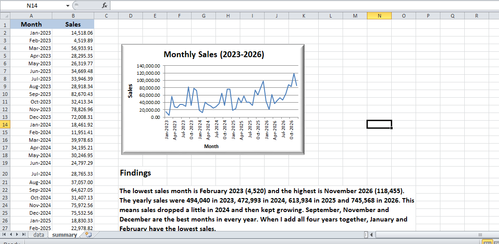

# Monthly Sales Trend (Superstore Dataset)

## Overview
Summarised sales by month for the Sample Superstore Orders data (2023 to 2026, 48 months)
and visualised the trend with a line chart in Excel.

## Workbook structure
- data:  Orders data
- summary: monthly table, line chart and findings

## Method
- Month list built with DATE and EDATE, so months are always in chronological order
- SUMIFS with date ranges (>= start of month, < start of next month) for monthly sales
- Checked that Order Date is a real date (not text)
- Line chart of monthly sales

## Results
- Total sales: 2,326,534.35 across 48 months
- Lowest month: Feb 2023 (4,519.89). Highest month: Nov 2026 (118,454.51)
- Yearly sales: 2023 494,040 | 2024 472,993 | 2025 613,934 | 2026 745,568
- September, November and December are the strongest months each year

## Tools Used
Microsoft Excel (DATE, EDATE, SUMIFS, line chart)

## Dataset
Sample Superstore Dataset

## Screenshot

